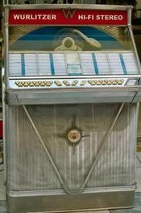
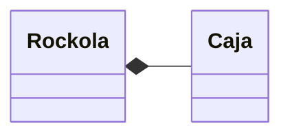

# 🎵 Rocola con Caja

> **Composición y Agregación** — [Ver solución](../)

  

## 📝 Enunciado

### Parte 1 · Rocola antigua

La rocola o rockola es un equipo de reproducción de música automatizado que funciona con monedas para reproducir discos de acetato, que el usuario selecciona a través del tablero.

- El tablero de la rocola está formado por **20 filas** (identificadas con los números del 1 al 20) y cada fila tiene **10 columnas** (identificadas de la letra `'A'` a la letra `'J'`), lo que le da a la rocola una capacidad para contener **200 discos** de acetato.
- Los discos contienen **dos canciones** (una por el lado A y otra por el lado B) y son interpretadas por el mismo artista.

Cuando una rocola es comprada no tiene discos disponibles para reproducir; es responsabilidad del propietario introducirlos a la rocola y, a través del teclado, configurarlos especificando en qué renglón y columna quedó asignado cada uno.

De igual manera, el usuario que quiera reproducir un disco primero debe pagar el importe correspondiente y después seleccionar el disco que desea reproducir, introduciendo **número de fila, columna y lado** del disco.

El importe de la canción es el mismo para todas las canciones.

### Parte 2 · Nueva funcionalidad

La rocola viene preparada con un dispositivo (**Caja**) para el manejo del efectivo que se requiere para que funcione.

- Cuando se crea la caja se debe especificar la cantidad de monedas o billetes de cada denominación que tendrá disponibles:

  | $200 | $100 | $50 | $20 | $10 | $5 | $2 | $1 |
  |:---:|:---:|:---:|:---:|:---:|:---:|:---:|:---:|

- Cuando se realice el pago para reproducir una canción, se debe especificar el número de billetes de cada denominación que interviene en el pago, regresando el cambio correspondiente.

> [!IMPORTANT]
> El pago se aceptará **solamente** si la caja tiene los billetes o monedas para dar el cambio exacto.
