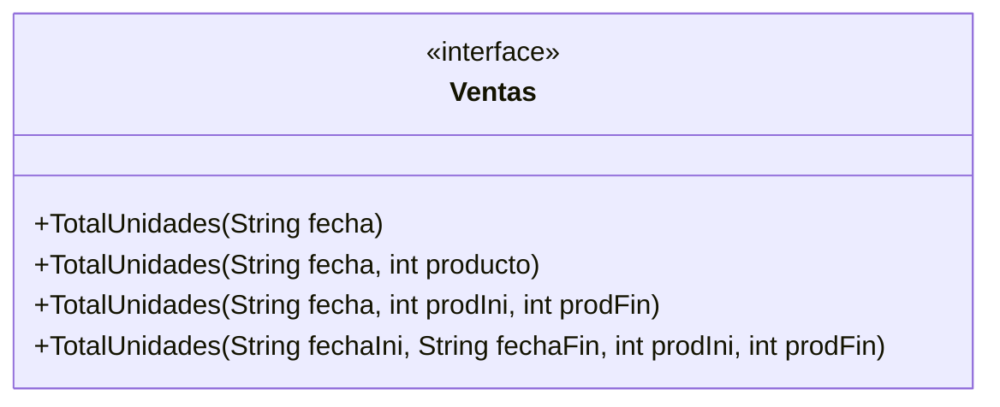

# 📈 Proyecto · Archivos directos (Ventas 2023)

> **Flujos y Archivos** — [Ver solución](../)

## 📝 Enunciado

Acaba de recibir el archivo de organización directa `Ventas2023.dat`, con el siguiente registro lógico:

| Campo | Tipo | Tamaño |
|---|---|---|
| `unidadesP1` | `int` | 4 bytes |
| `unidadesP2` | `int` | 4 bytes |
| … | … | … |
| `unidadesP100` | `int` | 4 bytes |
| **Longitud del registro** | | **400 bytes** |

> Cada registro representa un día del año: el archivo contiene **365 registros** con las ventas del **01/01/2023 al 31/12/2023** de **100 productos**.

Se desea que desarrolle una clase Java que implemente la siguiente interfaz:



| # | Método | Debe regresar las unidades vendidas… |
|:---:|---|---|
| 1 | `TotalUnidades(fecha)` | del 01/01/2023 a la fecha dada (`dd/mm/aaaa`), considerando los **100 productos**. |
| 2 | `TotalUnidades(fecha, producto)` | del 01/01/2023 a la fecha dada, considerando **del producto 1 al producto** proporcionado. |
| 3 | `TotalUnidades(fecha, prodIni, prodFin)` | del 01/01/2023 a la fecha dada, considerando el **rango de productos** proporcionado. |
| 4 | `TotalUnidades(fechaIni, fechaFin, prodIni, prodFin)` | en el **rango de fechas** establecido, considerando el **rango de productos** proporcionado. |

> [!NOTE]
> Todos los métodos deben obtener la información del archivo `Ventas2023.dat`.

---

## 📄 Código base proporcionado — `CrearArchivoVentas2023.java`

Genera el archivo `Ventas2023.dat` con datos aleatorios (10 a 50 unidades por producto por día).

```java
/*Ventas2023.dat
 * unidade2P1 int 4 bytes
 * unidadesP2 int 4
 *
 *
 * unidadesP3 int 4 bytes
 * Longitud del registro 400 bytes.
 * El archivo contiene 365 registros que representan
 * las ventas del 01/01/2023 al 31/12/2023
 */
import java.io.*;

public class CrearArchivoVentas2023 {

	public static void main(String[] args) {
		try {
			RandomAccessFile arch = new RandomAccessFile("Ventas2023.dat","rw");

			for(int i=0;i<365 ; i++) {
				for(int j=0; j<100;j++) {
					arch.writeInt((int)Rutinas.nextInt(10, 50));
				}
			}
			arch.seek(0);
			int unidades;
			for(int i=0;i<365 ; i++) {
				System.out.println("Dia # "+(i+1));
				for(int j=0; j<100;j++) {
					System.out.printf("%4d",arch.readInt());
					if((j+1)%20==0)
						System.out.println();
				}
				System.out.println();
			}
			arch.close();
		} catch (Exception e) {
			System.out.println("Algo salió mal");
			return;
		}
		System.out.println("Archivo creado exitosamente");

	}

}
```

> También está disponible como ejercicio de clase en [`archivos_directos`](../../../ejercicios/archivos_directos/CrearArchivoVentas2023.java).
