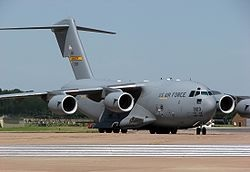
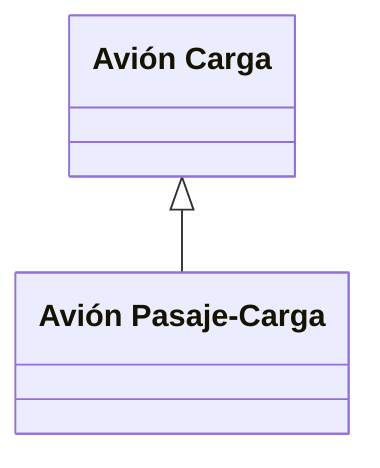

# ✈️ Ejercicio de Herencia · Aviones

> **Herencia y Polimorfismo** — [Ver solución](../)

<table align="center">
<tr><th>Carga</th><th>Pasajeros y carga</th></tr>
<tr>
<td></td>
<td></td>
</tr>
</table>

## 📝 Enunciado

Se desea que desarrolle las clases Java necesarias que implementen la jerarquía de clases que se muestra en el siguiente diagrama UML:



### Características de todo avión

Todo avión tiene establecido desde fábrica:

- Capacidad de carga de **T toneladas**.
- **Dos secciones** (izquierda y derecha) donde se acomodan las cajas de carga.
- En cada sección se pueden acomodar **N cajas**.

### Avión de carga

Los aviones de carga permiten que los productos que transportan vayan envasados en cajas cuyo contenido **no exceda el 1 %** de la capacidad de carga del avión.

Para que el avión de carga realice el despegue‑vuelo‑aterrizaje de forma segura, la carga debe mantener un equilibrio, por lo que se definieron las siguientes políticas:

1. Se sube al avión **una caja a la vez**.
2. Las cajas se acomodan **de la cola del avión hacia el frente**.
3. Las cajas se acomodan de manera **alterna** usando lado izquierdo y lado derecho (una caja del lado izquierdo y la siguiente del lado derecho).

Una vez finalizada la carga, se verifica que esté **balanceada**: los kilos del lado izquierdo y los del lado derecho no deben tener una diferencia que exceda el **10 %**.

Si la carga no está balanceada se deben realizar las siguientes acciones:

1. Ordenar todas las cajas de manera **descendente por kg** (mayor a menor).
2. Acomodar las cajas (iniciando con la de mayor peso y continuando de manera descendente) de manera alterna usando los lados izquierdo y derecho.

### Avión de pasaje‑carga

- **Carga:** funciona igual que el avión de carga, excepto que **N** (número de cajas por sección) es más pequeño.
- **Pasajeros:** el avión tiene una fila de asientos numerados del 1 al F (entre **50 y 100**).
- Al abordar, el pasajero presenta su pase de abordar, que contiene **nombre** y **número de asiento**.
- El primer pasajero se sienta en el **asiento del centro** y, a partir de ahí, el resto se sienta de manera alterna: **adelante – atrás**.

### Salida esperada

La aplicación debe imprimir información como:

```
Total de cajas : _____
Estado de la carga por:
  Lado izquierdo:
  Lado derecho:
Listado de personas en orden de abordaje:
```

### Ejemplo de uso

```java
Carga dhl = new Carga(100, 200); // capacidad de carga y cajas por sección
dhl.cargar(new Caja(1000));

if (dhl.Verificar())
    System.out.println("todo bien, puede despegar");
else {
    dhl.Balancear();
    System.out.println("ahora sí puede despegar");
}
```
