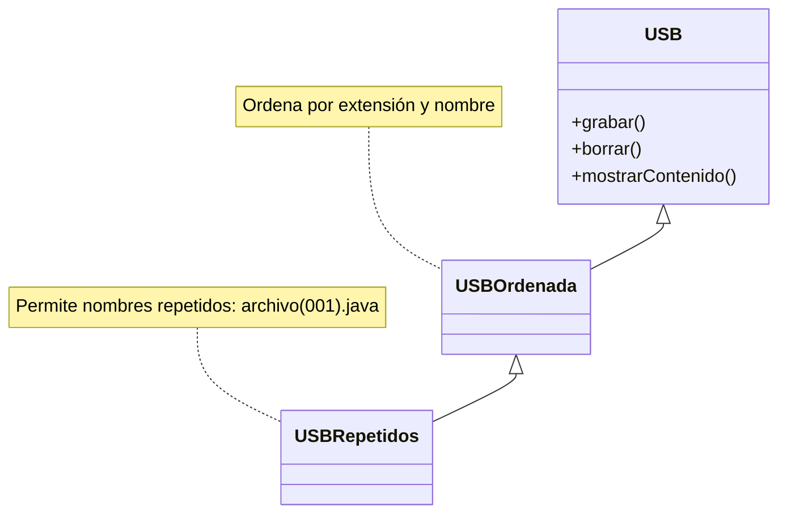

# 💾 Herencia en USB

> **Herencia y Polimorfismo** — [Ver solución](../)

<p align="center">
  
</p>

## 📝 Enunciado

Se desea que desarrolle una clase Java que modele el funcionamiento de una **USB**, utilizada para almacenar información.

La capacidad de almacenamiento de la USB se limita por:

- **Capacidad de espacio de almacenamiento**, normalmente expresada en GB.
- **Tipo de sistema de archivos** con el que se formateó: FAT32, NTFS o exFAT. Determina el número de archivos que puede contener:

  | Sistema de archivos | Número de archivos |
  |---|:---:|
  | FAT32 | 100 – 200 |
  | NTFS  | 50 – 99 |
  | exFAT | 10 – 20 |

Reglas:

- Los archivos que se almacenan en la USB tienen **nombre, extensión, tamaño, unidad de medida y fecha**.
- No permite nombres de archivo repetidos (mismo nombre y extensión).
- Los archivos grabados en la USB siempre hacen uso **contiguo** del espacio del disco.
- Existen tres operaciones básicas: **grabar**, **borrar** y **mostrar contenido**.

```java
USB roja = new USB(20, "NTFS");
```

### Nuevo requerimiento · `USBOrdenada`

Utilizando el mecanismo de herencia, defina una nueva clase `USBOrdenada` (adicional al funcionamiento de `USB`) que mantenga los archivos ordenados de manera **ascendente por extensión y nombre**. Cada vez que se grabe un archivo en la USB debe realizarse el ordenamiento.

### Nuevo requerimiento · `USBRepetidos`

Utilizando el mecanismo de herencia, defina una nueva clase `USBRepetidos` (adicional al funcionamiento de `USBOrdenada`) que permita archivos con nombre repetido (nombre y extensión); al nombre repetido debe agregarle el formato `(###)`. Por ejemplo:

```
archivo.java
archivo(001).java
archivo(002).java
```

### Jerarquía


